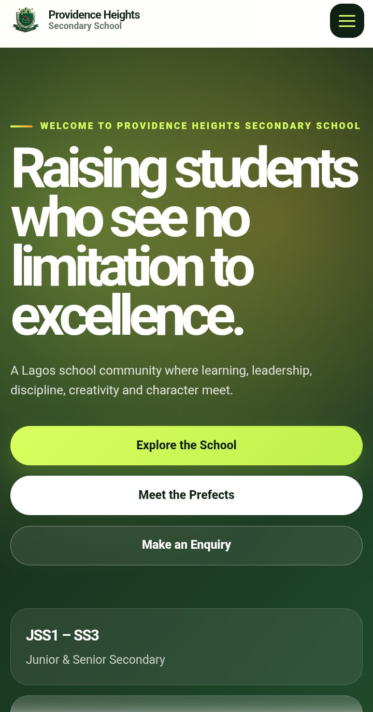

# Providence Heights mobile screenshot

This repository currently contains one reference screenshot of the Providence
Heights Secondary School website on a narrow mobile viewport. It is an
image-only repository: there is no application source, package manifest, build
command, deployment configuration, or test suite here.

For the maintained website project, see
[`gojocodes-all/Providence-heights`](https://github.com/gojocodes-all/Providence-heights).

## Asset

| File | Dimensions | Size | Encoded format |
| --- | ---: | ---: | --- |
| [`Screenshot_20260531-081450~2.png`](Screenshot_20260531-081450~2.png) | 720 × 1374 px | 132,059 bytes | JPEG |

The filename ends in `.png`, but the committed bytes identify the image as
JPEG. Tools that inspect content rather than relying only on the extension will
handle it correctly. Renaming the existing file would change its published
repository URL, so this guide documents the mismatch instead.

## Preview



## Viewing or downloading

Open the linked asset on GitHub to preview or download it. To inspect it
locally, clone the repository and open the image with any JPEG-compatible image
viewer:

```bash
git clone https://github.com/gojocodes-all/Pics.git
cd Pics
```

No dependency installation or build step is required.

## Updating the repository

- Keep documentation factual and based on committed files.
- If another reference image is added, document its filename, dimensions,
  encoded format, and relationship to the maintained website.
- Check the actual file signature instead of assuming the filename extension is
  accurate.
- Review rendered Markdown and relative links before merging changes.

## Reuse

No licence file is present. Do not assume the image is licensed for
redistribution or reuse outside this repository.
